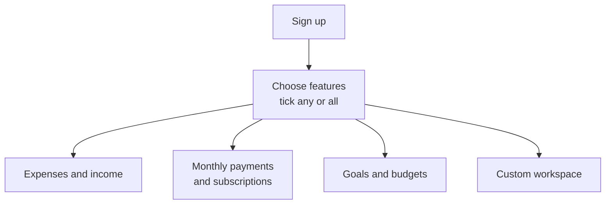
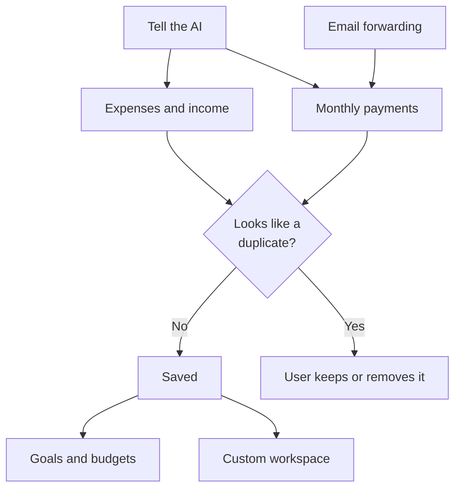
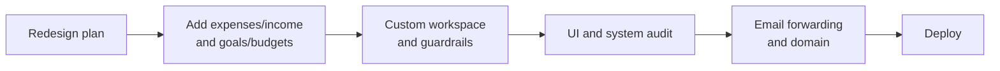

# Subtrack product design

Subtrack is a personal money workspace you can trust. It is ready to use from day one, simple enough for anyone, and customisable where it helps.

**Never:** no open banking, no OAuth, no investment or financial advice. Subtrack tracks; it does not advise.

## 1. Getting started

1. The user signs up.
2. They tick the features they want. Any combination works.
3. They only see what they ticked.
4. They can change this any time in Settings.

## 2. How data gets in

1. **Tell the AI:** "I spent $20 on lunch", "I got paid $1,200". It logs anything.
2. **Email forwarding:** bills, subscriptions and overdue notices arrive by themselves after a one-time Gmail filter setup.
3. **Duplicate check:** a new entry with the same name, a similar amount and a close date is flagged. The user decides; nothing is removed automatically.
4. **Goals and budgets** are built from the saved expenses, income and payments.
5. **Custom workspace:** the user describes a situation and the AI builds a page for it from our set of blocks, using their data.

### The AI assistant

- Works across all four features: it can log, change, explain and build pages.
- Only acts after the user approves.
- Only uses the blocks and templates we define.
- Tracking only. It can do maths on the user's own data ("how much can I spend a day?") but never recommends investments or financial products.

## 3. Build order

1. **Redesign plan:** plan the four-feature structure on top of what exists.
2. **Expenses/income and goals/budgets:** bring back the earlier features in the new design.
3. **Custom workspace and guardrails:** the new feature, built together with its safety rules.
4. **UI and system audit:** make every screen simple and flawless, including the workspace.
5. **Email forwarding and domain:** replace Gmail OAuth (see plan one).
6. **Deploy.**

## Not in for now

- CSV and bank statement imports
- Receipt scanning
- Paid features (the custom workspace may become paid later)
