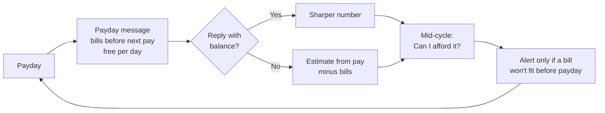

# Subtrack product design

*Revised 10 November 2026. Replaces the four-feature "money workspace" design.*

**Subtrack is a payday copilot.** Every payday it tells you what's already spoken for and what's actually yours to spend. No bank login.

**Who it's for:** young Australians paid weekly or fortnightly (students, shift and casual workers) who don't track their spending and won't start.

**Never:** open banking, OAuth for users, investment or financial product advice. Subtrack tracks; it does not advise.

## Why this shape

- **Manual logging dies.** The product must work if the user never logs a single expense.
- **Busy users don't come looking.** The value reaches them on payday as a message.
- **One number beats many screens.** "Free to spend: $X a day until Thursday" is the product.
- **Trust.** Every number comes from the backend, is dated, and states what's missing.

## The core loop

1. **Payday:** a message says pay is in, which bills land before the next pay, what's set aside for goals, and what's free per day.
2. **Optional balance:** typing one number makes it exact. Without it, the estimate uses pay amount minus bills and says so.
3. **Mid-cycle:** "Can I afford $120 Friday?" from the home screen, the app or the assistant.
4. **Rare alerts:** a bill that won't fit before payday, a trial ending, a price rise. Nothing else.

## Setup (under 3 minutes)

1. Pay schedule and usual pay amount.
2. Bills: tick from a list of common Australian services, or type or say one line ("Netflix 18.99 monthly, rent 400 weekly"). The user confirms each one.
3. Optional: today's balance and a savings goal.
4. Turn on the payday message.
5. See the first number.

## What the user sees

| Screen | Contains |
|---|---|
| **Home** | Free to spend until payday, bills before payday, "can I afford it?", needs attention |
| **Bills** | Recurring payments, paid history (paid, not paid yet, didn't happen), trials, ways to save |
| **Ask** | Assistant: questions and approval-only changes |
| **Account** | Pay schedule, payday message, goals, data export and delete |

- **Set aside each pay:** savings ("Trip, $100 a pay") and spending pots ("Eating out, $60 a pay") come off free-to-spend every payday.
- **Spent something?** Optional. A spend logged from a pot uses up the pot; any other spend lowers free-to-spend until the next balance. It's an adjustment, not a ledger.

## Removed (11 Nov 2026)

- The Transactions page, monthly budgets, old-style goals, the custom workspace and the feature picker.
- Spending pots replace budgets, savings set-asides replace goals, and "Spent something?" on Home replaces the Transactions page.

## Later, if users ask

- Email forwarding for bills ([plan one](plan-one-email-forwarding.md)).
- One statement upload per pay cycle for "where did my pay go?"
- Shared bills with housemates.
- Paid features.

## Success measures

- **Activation:** setup done and first number seen in under 3 minutes.
- **Retention:** payday message opened or a check-in at least once per pay cycle, over 2 cycles.
- **Pilot gate:** 20 real users. If fewer than 10 are still active after 2 cycles, revisit the wedge before building anything new.

Build plan: [plan four](plan-four-payday-copilot.md).
